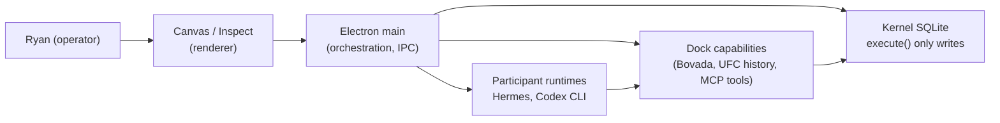

# QuantFlow — architecture map (one page)

**Status:** Verifier-maintained snapshot; not build authority. Authority: `START_HERE.md`, `docs/plans/INSTITUTION-CONTRACTS.md`, generated `qf-kernel-schema/golden/ONTOLOGY.md`.

## Product shape

QuantFlow is a **Windows Electron desk** (forked from Collaborator) with one **Canvas** for tiles, a **Dock** for governed equipment, **Inspect** for lineage detail, and a local **Kernel** (SQLite + typed ontology) as the only durable truth store.

## Repositories of truth (what each layer may do)

| Layer | Path | Job | Must not |
|---|---|---|---|
| **Schema contract** | `qf-kernel-schema/` | Objects, links, actions; generates `golden/` | Hand-edit `golden/`; serve writes except via defined actions |
| **Kernel runtime** | `packages/qf-kernel/` | `openKernel`, **`execute()`** — sole domain writer | Second write path; ad hoc SQL in product code |
| **Shell / orchestration** | `collab-electron/` | IPC, projections, species launch, Canvas tiles | Persist institutional state outside Kernel; domain writes without `execute()` |
| **Species** | `species/hermes`, `species/codex` | Prompts, allowlists, launch manifests, packed agents | Own truth; foreign `kernel_db` |
| **Dock tools** | `tools/qf-bovada-football`, `tools/qf-ufc-history`, `tools/qf-read-tools` | Data fetch, MCP read/action with grants | Write Kernel except through governed `execute()` / app gateway |
| **Quality** | `qa/` | Gates proving seams | Authorize product features |
| **Wiring map** | `qf-atlas/` | Generated IPC/write-door graph | Authorize deletes or features |

## Plug-in contract (Dock)

1. **Participant** — process with `agent_definition` + `agent_session`; works through Tasks; publishes Artifacts; may not grade its own output.
2. **Capability (Data/Tool)** — obeys capability grants (`capability_group`); produces `dataset` / `quote` / `run` / `artifact`; invoked only via app gateway or generated MCP tools.
3. **Handoff** — `publish_artifact` + `create_task` (or governed review/revision actions), never terminal prose as authority.
4. **Projection** — Canvas tiles render Kernel projections; controls dispatch **rejectable actions** (see `docs/LAWS.md`).

Codex and Hermes are **runtime species** under fixed roles (Director, worker, Critic); species does not change institutional semantics (`INSTITUTION-CONTRACTS.md` §1.3).

## Current critical path (W2-02)

The accepted stack stops after **one Codex result** and **one Critic round** without:

- Question Tasks (`task_kind = question`, `asks_about`, `answers`)
- `qf.question-answer.v1` and row `selection_ref` (`qf.comparison-row.v1`)
- Interactive evidence table tile (presentation-only sort/filter/select)
- Packaged gate `windows-collaborative-inquiry`

Substrate for revision exists (`request_revision` in `collab-electron/src/main/kernel.ts:1310`; collaboration gateway in `collaboration-gateway.ts`) but is **not wired** to the W2-02 journey or ontology.

## Verification commands (by intent)

| Intent | Command | Platform |
|---|---|---|
| Schema integrity | `cd qf-kernel-schema && bun test && bun run generate` | Any |
| Focused seam | `bun qa/run.ts <gate>` — `bun qa/run.ts --list` | Most gates Linux-safe |
| Windows product acceptance | `bun qa/verify-release.ts` | **Windows 11 native only** |
| Linux compatibility smoke | `bun qa/verify-release-linux.ts` | Linux (partial; not acceptance) |
| Wiring freshness | `bun qf-atlas/generate.mjs --check` | Any |

## Generated references

Prefer **`qf-kernel-schema/golden/ONTOLOGY.md`** and **`qf-atlas/ATLAS.md`** over prose counts in README or roadmap tables.
